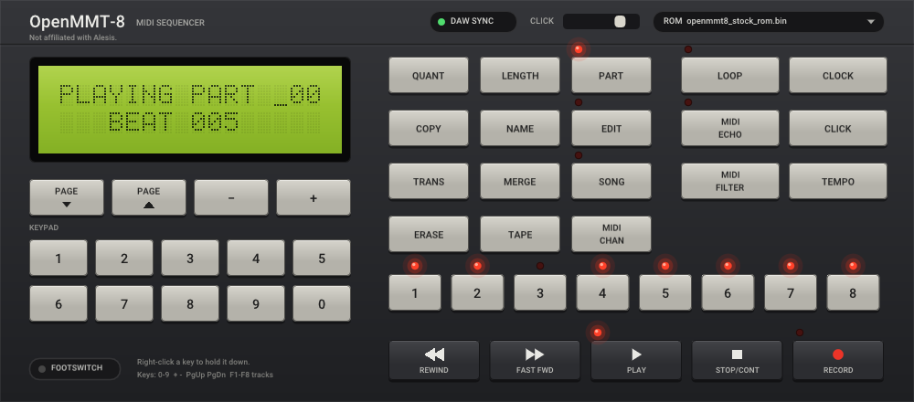

# OpenMMT-8

OpenMMT-8 is a MIDI sequencer ROM for MMT-8 hardware.
This repository also has JAM-8, a second ROM for the same hardware.
The CLAP plugin runs either ROM, with the panel, the display, and MIDI.

This project is not affiliated with Alesis.

> [!IMPORTANT]
> **OpenMMT-8 is free. If it is useful to you, please send a donation in bitcoin.**
>
> <table>
> <tr><td>⚡︎ Lightning</td><td><code>uadvanced@blink.sv</code></td></tr>
> <tr><td>₿ On-chain</td><td><code>bc1ptmpfgy84kuf6z3j07k9taswhpmjxpfex4xw8pzud0ljvnyd2yxpshp0g7r</code></td></tr>
> </table>
>
> This project is dedicated to Orbital. I performed in the late 90s with an MMT-8, and I would love for them to hear about it.




Read `MANUAL.md` for functions that the original unit does not have.
Read the manual of the unit for the original functions.
Read `jam8/MANUAL.md` for JAM-8.

## What the build gives you

| File | Contents |
| --- | --- |
| `dist/roms/openmmt8_rom.bin` | OpenMMT-8, with the part-edit extensions |
| `dist/roms/openmmt8_stock_rom.bin` | OpenMMT-8 stock profile, with tape save, load, and verify |
| `dist/roms/jam8_rom.bin` | JAM-8, the loop and pattern ROM |
| `dist/<platform>/mmt8_clap_plugin.clap` | The CLAP plugin, with OpenMMT-8 and JAM-8 built in |

Each ROM is a 32 KB image.
`dist/roms/SHA256SUMS` lists the checksums.
Each `dist/<platform>/` folder also has the ROMs, the manuals, and the license files.

## Requirements

- SDCC 4.2 or later (`sdcc` and `makebin`) and Python 3, for the ROMs.
- CMake 3.20 or later and a C++17 compiler, for the plugin.
- Linux: X11 and OpenGL development files for the panel.
- Windows: the plugin is cross-built on Linux or WSL with mingw-w64 (`x86_64-w64-mingw32-g++`).

Get the submodules with the clone:

```bash
git clone --recursive <repository-url>
```

In an existing clone, run `git submodule update --init`.

## Build the ROMs

```bash
bash tools/build_roms.sh
```

The script writes the three ROM files to `dist/roms/`.

## Build the plugin

Each script builds the ROMs, builds the plugin, loads the plugin once the way a host does,
and writes a release folder.
No script copies the plugin into a host folder.

| Platform | Command | Release folder |
| --- | --- | --- |
| Linux | `bash tools/build_clap_plugin_linux.sh` | `dist/linux/` |
| macOS, on a Mac | `bash tools/build_clap_plugin_macos.sh` | `dist/macos/` |
| Windows, from Linux or WSL | `bash tools/build_clap_plugin_windows.sh` | `dist/windows/` |

Copy `mmt8_clap_plugin.clap` into a folder that your host scans:

- Linux: `~/.clap/`, `/usr/local/lib/clap/`, or `/usr/lib/clap/`
- macOS: `~/Library/Audio/Plug-Ins/CLAP/` or `/Library/Audio/Plug-Ins/CLAP/`
- Windows: `%LOCALAPPDATA%\Programs\Common\CLAP\` or `%COMMONPROGRAMFILES%\CLAP\`

Keep `LICENSE`, `THIRD_PARTY_NOTICES.md`, and `LICENSES/` with the plugin file.

The Linux panel uses X11. The host must provide an X11 window.
The macOS build includes the panel. That panel has not been tested on a Mac.

## The ROMs

The plugin starts with OpenMMT-8.
Select "Use built-in JAM-8" in the ROM menu for JAM-8.
Load `openmmt8_stock_rom.bin` from the ROM menu for the stock profile.

The default OpenMMT-8 ROM has the part-edit extensions.
It does not have tape save, tape load, or tape sync.
The stock ROM has the tape functions.
It does not have the part-edit extensions.
Read `openmmt-8/README.md` for the details.

JAM-8 plays loops and writes patterns while it plays.
Read `jam8/MANUAL.md`.

## MIDI dump

Hold TAPE and press RECORD to send memory over MIDI.
In the stock ROM, this is the last page of the TAPE key.
The message is an OpenMMT-8 dump.
It starts with `F0 7D 4F 4D 38 01`.
OpenMMT-8 loads that message and restarts.
An original unit does not load this dump.
OpenMMT-8 does not load a dump from an original unit.
Read `MANUAL.md`.

## Tests

Build the emulator programs first:

```bash
cmake -S emulator -B emulator/build -DMMT8_EMU_ENABLE_CLAP=ON
cmake --build emulator/build -j
```

Then:

```bash
make -C openmmt-8 test   # OpenMMT-8 ROM probes
make -C jam8 test        # JAM-8 host tests and ROM probes
emulator/build/mmt8_clap_engine_test
emulator/build/mmt8_clap_host_test emulator/build/mmt8_clap_plugin.clap
```

## Plugin identity

The host shows the name OpenMMT-8.
The plugin id is `com.mmt8.emulator.stage2`.
Do not change that id.
A different id does not open saved projects.

## The emu8051 patch

The build applies `emulator/patches/emu8051-mmt8-hardware-fidelity.patch`.
CMake applies the patch during configuration.
Git then shows the emu8051 submodule as modified.
Do not commit that submodule change.
The patch file is the record of the change.

## License

The OpenMMT-8 and JAM-8 code is under the MIT license.
Read `LICENSE`.
Read `THIRD_PARTY_NOTICES.md` before you distribute the plugin.
The full license texts for the bundled components are in `LICENSES/`.

This repository does not contain the original unit's ROM or manual.
Load a ROM file only when you have the right to use that file.

## Other documents

- `openmmt-8/README.md`: OpenMMT-8 ROM development notes.
- `jam8/README.md`: JAM-8 ROM development notes.
- `emulator/README.md` and `emulator/frontends/clap/README.md`: the emulator and the plugin.
